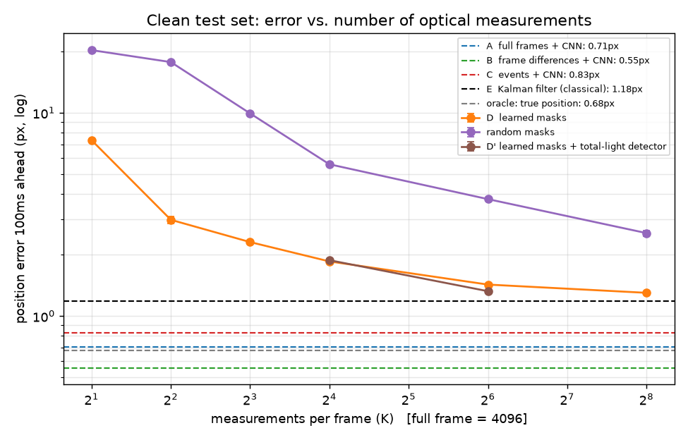
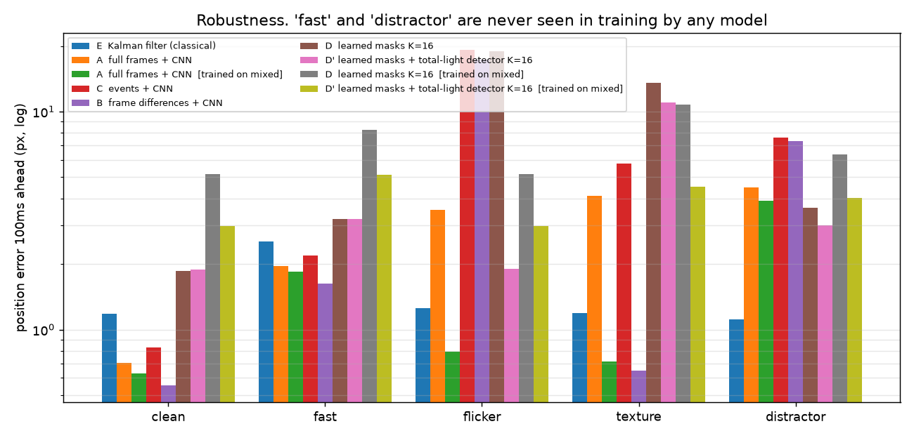
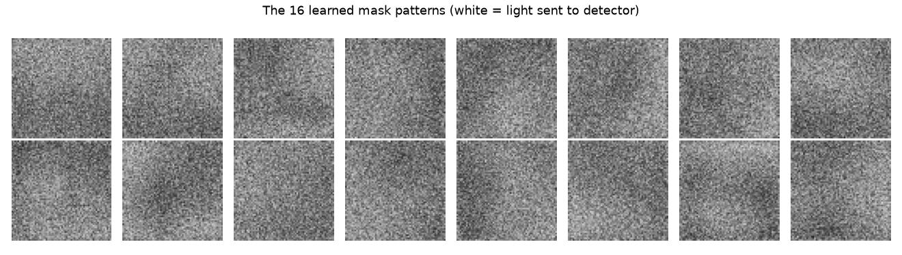

# Can a few optical measurements replace a full image for predicting motion?

> **Project layout**
> - This page: full write-up of **Experiment 1**, a 2D bouncing ball seen through K learned optical masks.
> - [`stereo/`](stereo/README.md): **Experiment 2**, a 3D ball seen by one or two "eyes".
> - [`site/`](site/): a one-page summary of both. View it with `cd site && ./serve.sh`,
>   then open http://localhost:8000.
>
> Saved mask tensors (`*.pt`) are not committed; training re-creates them, and their
> plots are included. Setup: `pip install -r requirements.txt`.

A small, fully simulated test of the idea: *instead of capturing a whole image and
extracting features in software, let the optics choose a handful of measurements
that are useful for predicting where things will move.*

The physically realistic version of "learned optics" used here is a **digital
micromirror device (DMD) + single-pixel detector**: each measurement is the total
light passing through one pattern (mask). The masks are learned end to end with
the predictor, then compared against conventional pipelines.

## Setup
- **World:** one ball bouncing in a box under gravity, rendered at 64×64
  (4096 pixels), 100 fps, with sensor noise. True positions are known exactly.
- **Task:** from 10 frames (100 ms) of history, predict the ball's position
  10, 50 and 100 ms ahead.
- **Training:** clean scenes only (plain background, steady light), unless noted.
- **Test conditions** (2000 sequences each): `clean`; `fast` (higher speeds than
  training); `flicker` (lighting oscillates ±30 % at 5–15 Hz); `texture` (cluttered
  static background); `distractor` (a second, dimmer ball).

| | Method | Readings / frame |
|---|---|---|
| A | full frames → CNN → GRU | 4096 |
| B | frame differences → CNN → GRU | 4096 |
| C | simulated event camera (log-brightness change events) → CNN → GRU | 8192 |
| D | **K learned masks** → small MLP → GRU | K |
| D' | K learned masks + one "total light" detector that divides out global brightness | K+1 |
| — | K fixed random masks (classic compressive sensing) | K |
| E | brightness-centroid detection + Kalman filter (no learning) | 4096 |
| — | oracle: GRU given the true position | 2 |

## Results (error 100 ms ahead, pixels; full table in `results.md`)

| | clean | fast | flicker | texture | distractor |
|---|---:|---:|---:|---:|---:|
| A full frames + CNN | 0.71 | 1.95 | 3.54 | 4.10 | 4.48 |
| A full frames + CNN, trained on mixed | 0.63 | 1.85 | 0.79 | 0.71 | 3.90 |
| C events + CNN | 0.83 | 2.19 | 19.18 | 5.80 | 7.62 |
| E Kalman filter | 1.18 | 2.54 | 1.25 | 1.19 | 1.11 |
| D learned masks K=16 | 1.86 | 3.21 | 18.95 | 13.55 | 3.62 |
| random masks K=16 | 5.58 | 8.90 | 16.75 | 13.60 | 7.02 |
| D' K=16 + total-light detector | 1.88 | 3.21 | 1.90 | 10.99 | 3.02 |
| D' K=64 + total-light detector, trained on mixed | 1.80 | 3.32 | 1.79 | 2.84 | 2.66 |

"Mixed" = training batches cycle through clean, flicker and texture (new random
textures each time). `fast` and `distractor` are never seen in training.





## What it shows
1. **Few measurements go a long way.** 16 learned masks predict 100 ms ahead
   within 1.9 px (~3 % of the field of view) vs 0.7 px from full frames, with
   256× fewer readings and ~300× fewer digital FLOPs in the encoder.
2. **Learning the masks matters.** Learned masks beat random ones by 2–6× at
   every K (3× at K=16, largest at K=4–8, shrinking to 2× at K=256). The learned masks are smooth light/dark ramps:
   the optimiser roughly rediscovered a *position-sensitive detector*.
3. **Task-tuned optics are fragile.** Trained on clean scenes, the mask models
   fail under flicker (18–26 px at every K) and textured backgrounds (~13 px): a
   weighted sum of light cannot tell "the ball moved" from "the lights dimmed".
4. **The fix can be optical.** Adding one photodiode that measures total light,
   and dividing by it, removes the flicker failure completely (18.95 → 1.90 px)
   at no cost on clean scenes. With that detector, training on varied scenes
   then also fixes texture (K=64: 2.84 px). Without the detector, varied
   training makes everything *worse* (clean error 5–8 px).
5. **The fair comparison is still a trade-off, not a win.** Given the same
   varied training, full frames + CNN gets 0.6–0.8 px on clean/flicker/texture,
   while the best mask model (65 readings) gets 1.8–2.8 px: about 3× the error
   for 63× fewer readings and far less digital compute. Whether that is worth it
   depends entirely on whether bandwidth/power or accuracy is the bottleneck.
6. **Classical tracking is a strong baseline.** Centroid + Kalman filter needs
   no training, is the best method at 10 ms, the best on the unseen distractor
   condition, and never fails badly. For simple, known physics, learned
   sensing is not needed. The case for it is dynamics that are hard to model by
   hand, which is also where a few measurements are least likely to suffice.

## Caveats
- One simple object on a tiny simulated sensor; this is a sanity check, not a
  result about real robots.
- FLOPs stand in for latency; no hardware timing. A real DMD shows masks
  one after another (~20 kHz), so K=16 ≈ 1.25 kHz effective rate. Fixed printed
  masks in front of K separate photodiodes would avoid that.
- Events are binned at the 100 fps frame rate, which hides an event camera's
  main advantage (microsecond timing).
- Most frame/event/mixed rows are one seed; mask rows (non-mixed) are 3 seeds
  with small spread (see `results.md`).
- The oracle is a rough reference, not a strict bound (frame differences beat
  it slightly, so its predictor is probably under-trained).
- The Kalman filter's detector uses the full frame; its digital cost is small
  (a centroid over 4096 pixels) but not zero.

## Run it
```bash
pip install -r requirements.txt
./run_all.sh          # main sweep (~35 min on 15 CPU cores)
./run_followups.sh    # total-light detector + mixed training (~15 min)
python3 analyze.py    # rebuild plots and results.md from results/
```
Single run: `python3 train.py --method mask --k 16 [--train-cond mixed] [--seed 1]`.
On an Apple Silicon Mac, PyTorch uses the MPS GPU automatically; use fewer
parallel jobs, e.g. `JOBS=2 ./run_all.sh`.

Files: `sim.py` (world, rendering, event model), `models.py` (encoders +
predictor), `train.py` (train/evaluate one method), `kalman.py` (classical
baseline), `analyze.py` (plots + table).
