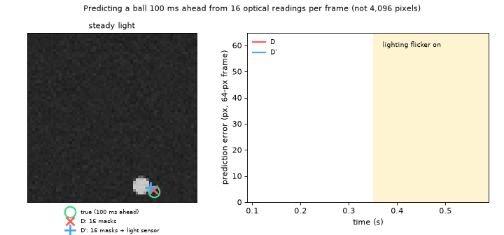

# Learned optical sensing for motion prediction

> **Work in progress, simulation only.** Nothing here has been tested on real optics yet.



Can a sensor's optics choose a few useful measurements instead of capturing a whole image?
Here a ball bounces in a simulated 64×64 scene (4,096 pixels). Each frame, the "camera" takes just
**16 readings**: the total light through 16 learned patterns, like a micromirror array in front of
one photodiode. A small network uses those readings to predict where the ball will be 100 ms later.

In the GIF, both models were trained only on steady lighting. When the light starts to flicker, the
plain 16-mask model (red) gets lost, because it can't tell "the ball moved" from "the lights
dimmed". Adding one detector that measures total light (blue) fixes that.

| 100 ms ahead, error in px | steady light | flicker |
|---|---:|---:|
| full frames + CNN (4,096 readings) | 0.71 | 3.54 |
| 16 learned masks | 1.86 | 18.95 |
| 16 learned masks + total-light detector | 1.88 | 1.90 |
| classical tracker (centroid + Kalman filter) | 1.18 | 1.25 |

The classical tracker is still hard to beat on a scene this simple. More results, baselines and
caveats are in [FINDINGS.md](FINDINGS.md), and a 3D two-camera follow-up is in [stereo/](stereo/).

```sh
pip install -r requirements.txt
python demo.py                                  # trains two small models on CPU, writes demo/demo.gif
python train.py --method mask_norm --k 16       # one full train + evaluation run
```
