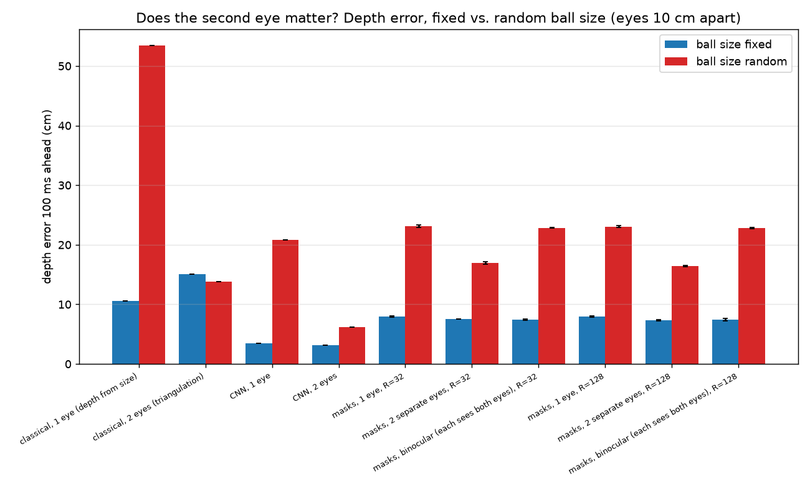
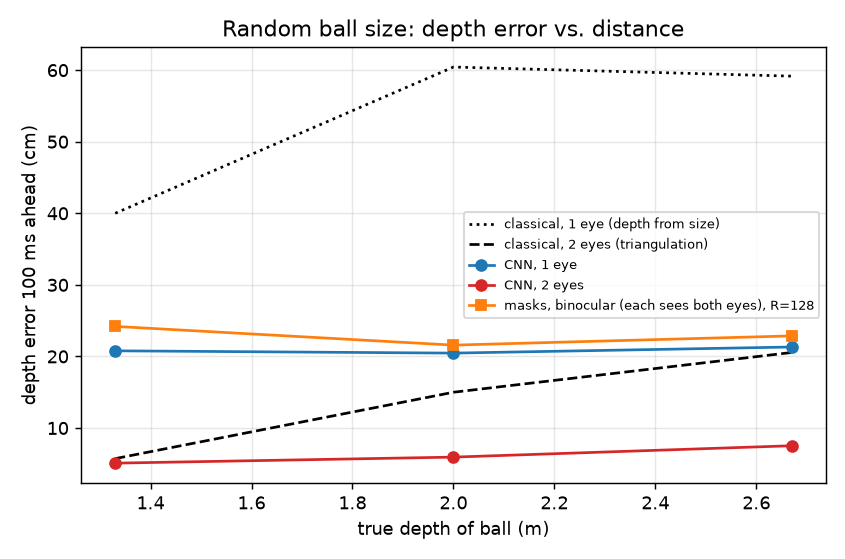
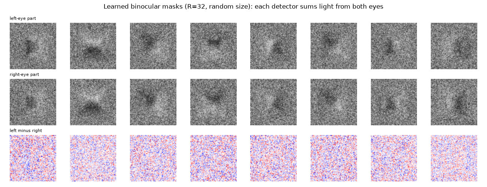
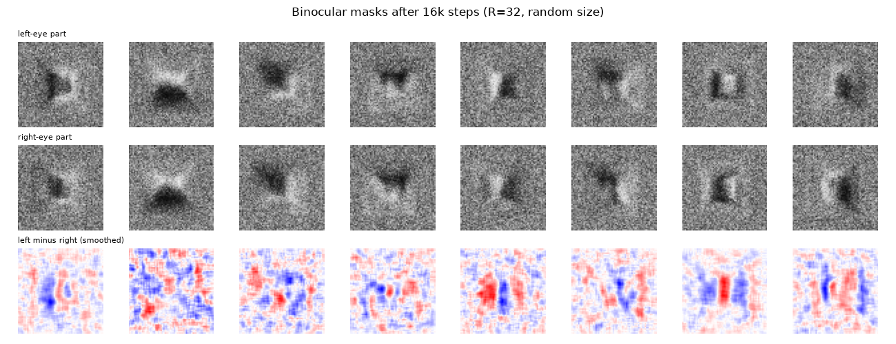

# Two eyes: does a second viewpoint help predict motion in 3D?

Follow-up to the 2D experiment in `..`. A ball bounces in a 3D box (1 to 3 m
away) and is seen by one or two simulated pinhole cameras ("eyes") with 64×64
pixels each. Models see 100 ms of history and predict where the ball will be
10, 50 and 100 ms later, in metres.

**The key manipulation is ball size.** With a fixed, known size, one eye can
judge distance from how big the ball looks. With a random size (4× range), a
big far ball and a small near one look identical, so only the second eye's
viewpoint (disparity) can tell distance reliably.

## Setups
| Setup | What it sees |
|---|---|
| classical, 1 eye | find the ball; depth from apparent size assuming a typical radius; Kalman filter |
| classical, 2 eyes | find the ball in both images; depth by triangulation; Kalman filter |
| CNN, 1 / 2 eyes | full images (2 eyes stacked as channels) → CNN → GRU |
| masks, 1 eye | R learned optical masks on one eye |
| masks, 2 separate eyes | R/2 masks on each eye (two single-pixel cameras) |
| masks, binocular | R masks that each sum light from *both* eyes on one detector (a beam combiner in front of the mask) |
| self-supervised CNN, 1 / 2 eyes | trained only to predict its own future frames; never sees a position or depth label |

All mask setups use the same total readings per frame (R = 32 or 128), so
1-eye vs 2-eye comparisons are fair. Mask rows: 2 seeds; others: 1 seed.

## Results (error 100 ms ahead, cm; full tables in `results3d.md`)

| setup | fixed size: depth | random size: depth | random: lateral |
|---|---:|---:|---:|
| classical, 1 eye | 10.5 | 53.5 | 11.9 |
| classical, 2 eyes | 15.1 | 13.8 | 11.7 |
| CNN, 1 eye | 3.5 | 20.8 | 4.2 |
| CNN, 2 eyes | 3.1 | **6.2** | 3.2 |
| masks, 1 eye, R=32 | 8.0 | 23.1 | 7.9 |
| masks, 2 separate eyes, R=32 | 7.5 | 17.0 | 7.7 |
| masks, binocular, R=32 | 7.5 | 22.9 | 7.7 |
| masks, 2 separate eyes, R=128 | 7.3 | 16.4 | 7.4 |
| masks, binocular, R=128 | 7.4 | 22.8 | 7.6 |

Eye separation (CNN, 2 eyes, random size), depth error: 1 eye 20.8 · 3 cm 8.4 ·
10 cm 6.2 · 30 cm 4.8.





## What it shows
1. **The second eye matters exactly when size is ambiguous.** With a known
   ball size, one eye is almost as good as two (CNN depth error 3.5 vs 3.1 cm).
   With random sizes, one eye's error jumps to 20.8 cm and two eyes bring it
   back to 6.2 cm. Even eyes 3 cm apart more than halve the error, and wider
   separation keeps helping (4.8 cm at 30 cm), as triangulation predicts.
2. **Classical triangulation degrades with distance** (5.7 → 20.6 cm from near
   to far), as stereo geometry predicts: disparity shrinks as 1/distance, so a
   fixed pixel error becomes a growing depth error. The learned two-eye CNN
   degrades much less (5.1 → 7.5 cm). With a known size, apparent size was a
   *more* precise depth cue than a 10 cm stereo baseline on this tiny sensor.
3. **Few-measurement sensing benefits from two eyes, but much less.** Splitting
   32 readings across two eyes cuts random-size depth error from 23 to 17 cm
   (11.4 cm with 4× longer training), still well behind the full-image stereo
   CNN (6.2 cm), which uses 256× more readings.
4. **Binocular masks learn stereo slowly, and they learn it like neurons do.**
   After the standard 4,000 steps, masks that sum both eyes' light on one
   detector were no better than one eye: they learned the *same* pattern for
   both eyes, so each detector just added the two views together and threw
   disparity away. Trained 4× longer (16,000 steps, one seed), they do start
   to use the second eye (depth error 22.9 → 16.7 cm at R=32), and the masks
   change character: in several of them the left-eye pattern becomes a
   *horizontally shifted* copy of the right-eye pattern (vertical red/blue
   stripes in the "left minus right" row below). A detector like that responds
   most to one particular disparity, which is the "position-shift" model of
   disparity-tuned neurons in visual cortex. Separate per-eye masks still win
   (11.4 cm after 16,000 steps), so summing the eyes optically makes the
   problem harder to learn, at least with this training setup.

   | 16,000 training steps, random size, 1 seed | depth 100 ms | lateral 100 ms |
   |---|---:|---:|
   | masks, 2 separate eyes, R=32 | 11.4 | 4.9 |
   | masks, binocular, R=32 | 16.7 | 5.3 |
   | masks, binocular, R=128 | 19.2 | 5.3 |

   

   The 4,000-step mask results in the main table are therefore under-trained;
   the CNN rows were converging well by then, the mask rows were not.
5. **Depth partly emerges without being taught, but the second eye did not
   help that.** Models trained only to predict their own future frames encode
   depth well above an untrained control (linear readout R² 0.69 with one eye,
   0.72 with two, vs 0.25–0.33 for random weights). With depth labels, two
   eyes reach R² 0.99. So predicting blurry 64×64 frames 50–100 ms ahead did
   not require the model to use disparity; a stronger self-supervised
   objective (or higher resolution) would be needed to test this properly.

## Caveats
- One simple object, tiny 64×64 sensors, simulated optics, no real timing.
- Disparity here is only 1.7–4.8 px (eyes 10 cm apart), so stereo works at
  the edge of the sensor's resolution; that favours apparent size as a cue
  when size is known.
- Gravity gives a single eye a weak extra depth cue (a falling ball's apparent
  acceleration shrinks with distance); the 1-eye CNN beating classical size-based
  depth (20.8 vs 53.5 cm) suggests it uses cues like this.
- The self-supervised result is one objective, one seed; treat it as a first
  look, not a conclusion about "implicit 3D understanding".

## Run it
```bash
./run_stereo.sh       # ~1 h on 15 CPU cores; on a Mac: JOBS=2 ./run_stereo.sh
python3 analyze3d.py  # rebuild plots and results3d.md
# longer mask runs reported above (results go to results_long/):
python3 train3d.py --setup bino_mask --readings 32 --size random --steps 16000 --out results_long
```
Single run: `python3 train3d.py --setup sep_mask --readings 32 --size random [--baseline 0.3] [--steps 16000]`.
